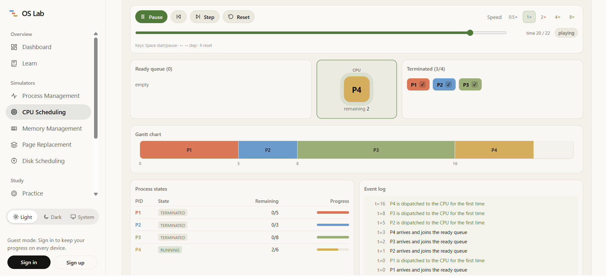
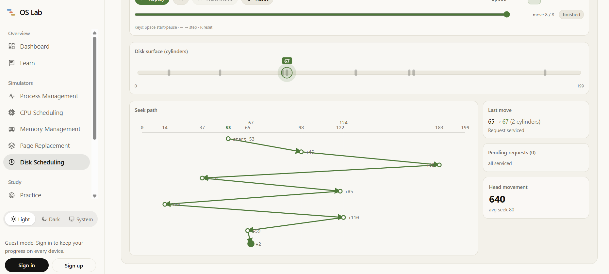

<div align="center">

# OS Lab – Interactive Operating Systems Simulator

**Run real operating-systems algorithms, watch them execute step by step, and check your hand calculations.**

[](https://github.com/lankyghana/OS-Lab-Interactive-Operating-Systems-Simulator/actions/workflows/ci.yml)
[](LICENSE)


[Repository](https://github.com/lankyghana/OS-Lab-Interactive-Operating-Systems-Simulator) ·
[Architecture](docs/ARCHITECTURE.md) ·
[Contributing](CONTRIBUTING.md) ·
[Security](SECURITY.md)

</div>

---

## Table of contents

- [Overview](#overview)
- [Key features](#key-features)
- [Supported algorithms](#supported-algorithms)
- [Screenshots](#screenshots)
- [Technology stack](#technology-stack)
- [System architecture](#system-architecture)
- [Getting started](#getting-started)
- [Environment variables](#environment-variables)
- [Using the platform](#using-the-platform)
- [Testing and quality assurance](#testing-and-quality-assurance)
- [Deployment](#deployment)
- [Project structure](#project-structure)
- [Conventions used by the simulators](#conventions-used-by-the-simulators)
- [Contributing](#contributing)
- [Security](#security)
- [Licence](#licence)
- [Acknowledgements](#acknowledgements)

## Overview

OS Lab is an interactive learning platform for **university students taking an Operating Systems course**. Scheduling, memory allocation, page replacement and disk scheduling are usually taught with static diagrams and hand-worked tables, which makes it hard to see *why* an algorithm makes each decision and easy to make arithmetic slips.

OS Lab lets students:

- **Watch** an algorithm run one step at a time, with a plain-English explanation of every decision.
- **Calculate** the same scenario in a table view and compare the results with their own working.
- **Compare** algorithms side by side on identical input.
- **Learn** each concept from a written topic with a live worked example, then **practise** with generated exercises and quizzes.

Every algorithm is implemented once, in a framework-independent TypeScript package ([packages/engine](packages/engine)). The visual lab, the calculator and the compare view all render the same result object, so they cannot disagree. The engine is verified by unit tests against textbook answers.

Guests can use every simulator without an account. Creating an account adds saved history, progress, favourites and cross-device exercise results.

## Key features

### Process Management

- Five-state process model: New, Ready, Running, Waiting, Terminated.
- Creation of processes with Process Control Blocks (PCBs), ready and waiting queues, and a kernel log.
- Invalid transitions are rejected with an explanation, as a real kernel would refuse them.
- **Visual lab** with a *Sandbox* (create processes and click transition buttons) and an *Auto scenario* (a generated lifecycle plays out), plus a typed **Command console** that drives the same system.

### CPU Scheduling

- Six scheduling policies with a ready queue, CPU, Gantt chart, per-process state table and event log.
- Results table with completion, turnaround, waiting and response times, averages and CPU utilisation.
- Presets (course example, convoy effect, staggered arrivals), a random-workload generator and a side-by-side comparison of all algorithms.

### Memory Management

- First Fit, Best Fit and Worst Fit allocation with **variable** (hole-splitting) or **fixed** partitioning.
- Memory map with the blocks examined for each request, allocation table, utilisation and fragmentation figures.
- Textbook example, random generator and side-by-side comparison.

### Page Replacement

- FIFO, LRU and Optimal replacement over a reference string and a chosen number of frames.
- Physical frames, a hit/fault trace table and a plain-English reason for every fault.
- Textbook reference string, a Belady's anomaly example, a random generator, and a faults-versus-frames comparison.

### Disk Scheduling

- Six head-scheduling policies over a request queue, start position, disk size and sweep direction.
- Disk surface with a moving head, a seek-path graph, a move table, total head movement and average seek.
- Option to include or exclude the C-SCAN return sweep in the total, and a side-by-side comparison.

### Interactive learning modules

- **Learn**: 16 topics, each with what / why / how, pros and cons, formulas where relevant, a live worked example that opens in the matching simulator, a link to related exercises, and further reading.

### Practice exercises and quizzes

- **Calculation exercises** for CPU scheduling, memory, page replacement and disk scheduling at easy, medium and hard difficulty. Exercises are generated deterministically from a seed, graded on submission, and come with a worked solution.
- **Quizzes**: 30 multiple-choice questions across the five modules, each with an explanation.

### Learning resources

- A library of 19 curated books, courses, videos, references and hands-on projects. Filter by type, and mark items as saved or done.

### Dashboard and progress tracking

- A dashboard with the simulation labs and recommended next topics.
- A progress page with learning statistics and history, with simulations per module, a summary, saved and completed resources, and recent activity (simulations, quizzes and exercises).

### User accounts and authentication

- Email and password registration and sign-in, plus **Sign in with Google** (OAuth 2.0).
- JWT-protected API. A Google sign-in with an email that already has an account links to it.
- Offline-first progress: it is stored in the browser for guests, and synced to the server when signed in.
- Light, dark and system themes.

## Supported algorithms

### CPU scheduling

| Algorithm | Type | Notes |
|---|---|---|
| First Come, First Served (FCFS) | Non-preemptive | Runs in arrival order; shows the convoy effect |
| Shortest Job First (SJF) | Non-preemptive | Shortest burst among arrived processes |
| Shortest Remaining Time First (SRTF) | Preemptive | Preemptive SJF |
| Priority (non-preemptive) | Non-preemptive | Lower number = higher priority |
| Priority (preemptive) | Preemptive | Running process is preempted by a higher-priority arrival |
| Round Robin (RR) | Preemptive | Configurable time quantum |

### Memory management

| Algorithm | Strategy |
|---|---|
| First Fit | First hole large enough |
| Best Fit | Smallest hole large enough |
| Worst Fit | Largest hole |

Each runs in *variable* partition mode (holes are split) or *fixed* partition mode (one process per block, with internal fragmentation reported).

### Page replacement

| Algorithm | Victim chosen |
|---|---|
| FIFO | Page that has been in memory longest |
| LRU | Least recently used page |
| Optimal | Page whose next use is furthest in the future |

### Disk scheduling

| Algorithm | Behaviour |
|---|---|
| FCFS | Requests in arrival order |
| SSTF | Nearest request first |
| SCAN (Elevator) | Sweeps to the physical end of the disk, then reverses |
| C-SCAN | Sweeps one way to the end, then returns to the start |
| LOOK | Like SCAN, but reverses at the last request |
| C-LOOK | Like C-SCAN, but jumps from the last request |

The sweep direction (higher or lower cylinders first) is configurable. The engine marks FCFS, SSTF, SCAN and C-SCAN as the core set and LOOK and C-LOOK as extras.

## Screenshots

| Process Management | CPU Scheduling |
|---|---|
|  |  |

| Page Replacement | Disk Scheduling |
|---|---|
|  |  |

## Technology stack

| Area | Technologies |
|---|---|
| **Frontend** | [Next.js 15](https://nextjs.org/) (App Router), React 19, TypeScript, [Tailwind CSS 4](https://tailwindcss.com/), shadcn-style components built with `class-variance-authority`, `clsx` and `tailwind-merge`; custom SVG/HTML charts |
| **Backend** | [NestJS 10](https://nestjs.com/) on Express, `class-validator` / `class-transformer` for request validation, `@nestjs/throttler` for rate limiting, `@nestjs/config` |
| **Database and ORM** | PostgreSQL 16 (via Docker Compose for local development), [Prisma 5](https://www.prisma.io/) |
| **Simulation engine** | `@os-lab/engine`: dependency-free TypeScript, shared by the frontend and the API |
| **Authentication** | Passport (`passport-jwt`, `passport-google-oauth20`), `@nestjs/jwt`, `bcryptjs` |
| **Testing** | [Vitest](https://vitest.dev/) (engine and API), [Playwright](https://playwright.dev/) (end-to-end, desktop and mobile) |
| **Development tools** | pnpm workspaces (monorepo), TypeScript compiler (`tsc`), Nest CLI, esbuild (standalone demo build), GitHub Actions |
| **Deployment** | Frontend on [Vercel](https://vercel.com/), API and database on [Render](https://render.com/) (blueprint in [render.yaml](render.yaml)) |

## System architecture

```
Browser ──► Next.js (apps/web) ──► NestJS API (apps/api) ──► PostgreSQL
               │                          │
               └────── @os-lab/engine ────┘   (same TypeScript package on both sides)
```

- **`packages/engine`** does all algorithm work. Each engine is a pure function that returns a complete trace plus summary metrics. The API reuses it to generate and grade exercises server-side.
- **`apps/web`** renders engine output. Route files in `src/app` are thin; all UI lives in `src/features/<module>`. Progress is written to the browser first and synced to the API when the student is signed in.
- **`apps/api`** provides authentication, user profiles, progress, simulation history, practice grading and resource bookmarks, persisted with Prisma.

The engine contract, frontend design, data model and the full API reference are in [docs/ARCHITECTURE.md](docs/ARCHITECTURE.md).

## Getting started

### Prerequisites

- [Node.js](https://nodejs.org/) 20 or later
- [pnpm](https://pnpm.io/) 9 (the repository pins `pnpm@9.12.0`; run `corepack enable` to use it)
- [Docker](https://www.docker.com/), only if you want the API and database

### Clone and install

```bash
git clone https://github.com/lankyghana/OS-Lab-Interactive-Operating-Systems-Simulator.git
cd OS-Lab-Interactive-Operating-Systems-Simulator
pnpm install
```

### Option A: frontend only (guest mode, no database)

Leave `NEXT_PUBLIC_API_URL` unset. The app then runs in guest-only mode and keeps progress in the browser.

```bash
pnpm --filter @os-lab/engine build
pnpm dev:web          # http://localhost:3000
```

### Option B: full stack (web + API + PostgreSQL)

```bash
# 1. Configure environment (see "Environment variables" below)
cp apps/api/.env.example apps/api/.env          # set JWT_SECRET
cp apps/web/.env.example apps/web/.env.local

# 2. Start PostgreSQL (Docker Compose service "db")
pnpm db:up

# 3. Create the tables
pnpm db:migrate

# 4. Start the web app and the API
pnpm dev              # web on :3000, API on :4000
```

`pnpm db:migrate` runs `prisma migrate dev`. The repository does not yet include committed migration files, so on the first run Prisma asks you to name the initial migration (for example `init`) and creates it.

To enable Google sign-in, create an OAuth client of type *Web application* in the [Google Cloud console](https://console.cloud.google.com/apis/credentials) with the redirect URI `http://localhost:4000/auth/google/callback`, then set `GOOGLE_CLIENT_ID` and `GOOGLE_CLIENT_SECRET`.

### Standalone demo build

```bash
pnpm build:demo
```

Bundles the real frontend features into a single self-contained `dist/os-lab-demo.html` (guest mode, hash router), which is useful for sharing a preview without hosting. The script is [tools/build-demo.mjs](tools/build-demo.mjs).

## Environment variables

Copy the `.env.example` file in each app and edit it. Never commit real secrets: `.env` and `.env.local` are git-ignored.

### API: [apps/api/.env.example](apps/api/.env.example) → `apps/api/.env`

| Variable | Required | Default | Description |
|---|---|---|---|
| `DATABASE_URL` | Yes | Example points to the local Docker database | PostgreSQL connection string used by Prisma |
| `JWT_SECRET` | Yes | `change-me` in the example | Secret used to sign access tokens. Use a long random value, for example `openssl rand -hex 32`. The API will not start without it |
| `JWT_EXPIRES_IN` | No | `7d` | Access-token lifetime |
| `PORT` | No | `4000` | Port the API listens on |
| `WEB_URL` | No | `http://localhost:3000` | Frontend origin(s), comma-separated. Used for CORS and as the Google OAuth redirect target |
| `GOOGLE_CLIENT_ID` | For Google sign-in | empty | Google OAuth client ID |
| `GOOGLE_CLIENT_SECRET` | For Google sign-in | empty | Google OAuth client secret |
| `GOOGLE_CALLBACK_URL` | For Google sign-in | `http://localhost:4000/auth/google/callback` | OAuth callback URL; must match the one registered with Google |

### Web: [apps/web/.env.example](apps/web/.env.example) → `apps/web/.env.local`

| Variable | Required | Default | Description |
|---|---|---|---|
| `NEXT_PUBLIC_API_URL` | No | `http://localhost:4000` in the example | URL of the NestJS API. **Leave empty to run in guest-only mode** (progress kept in the browser) |

## Using the platform

1. **Start at the dashboard.** It lists the five simulation labs and recommended topics. The sidebar also links to Learn, Practice, Resources and your progress.
2. **Open a simulator** from the sidebar: Process Management, CPU Scheduling, Memory Management, Page Replacement or Disk Scheduling.
3. **Set up a scenario.** Choose an algorithm, then edit the input or load a preset, textbook example or random scenario.
4. **Run it in the Visual lab.** Playback controls are shared by all simulators:

   | Control | Action | Keyboard |
   |---|---|---|
   | Start / Pause / Resume | Play or pause the animation | `Space` |
   | Step | Advance one step | `→` |
   | Back | Go back one step | `←` |
   | Reset | Return to the start | `R` |
   | Speed | 0.5×, 1×, 2×, 4× or 8× | none |
   | Timeline slider | Jump to any step | none |

5. **Read the explanation.** Each step shows what just happened (for example, which page was replaced and why), alongside the state, event log or trace.
6. **Check your answer in the calculator.** The text tab shows the full results table (waiting and turnaround times, frame table, move table, allocation table and so on). In Process Management this tab is a command console. Type `help` in the console to list its commands.
7. **Compare algorithms.** The Compare tab runs every algorithm on the same input (page replacement compares faults against frame count).
8. **Learn.** Open a topic from **Learn**; its worked example opens in the matching simulator with that input preloaded.
9. **Practise.** In **Practice**, choose a module and difficulty for a calculation exercise, or take a module quiz.
10. **Track progress.** **My Progress** shows your statistics and history. Sign in (email or Google) to keep progress across devices; as a guest it stays in your browser.

## Testing and quality assurance

| Task | Command | Notes |
|---|---|---|
| Unit tests (engine + API) | `pnpm test` | Vitest. 31 engine tests against textbook answers, plus API unit tests |
| Type checking | `pnpm typecheck` | Runs `tsc --noEmit` in every workspace package |
| End-to-end tests | `pnpm test:e2e` | Playwright, desktop and mobile. Build the web app first |
| Production build | `pnpm build` | Builds the engine, generates the Prisma client, then builds the API and web app |

End-to-end tests run against `pnpm start`, so build the web app and install a browser first:

```bash
pnpm --filter @os-lab/web build
pnpm --filter @os-lab/web exec playwright install chromium
pnpm test:e2e
```

The [GitHub Actions workflow](.github/workflows/ci.yml) runs the engine build, Prisma client generation, type checking, unit tests, the web build and the Playwright suite on every push and pull request.

**Linting:** `apps/web` defines a `lint` script (`next lint`), but no ESLint configuration is committed, so linting is not currently part of the checks. There are no separate integration tests; API coverage is unit-level.

## Deployment

The frontend and the API deploy separately.

### Frontend → Vercel

1. Import the repository in Vercel.
2. Set **Root Directory** to `apps/web`.
3. Set `NEXT_PUBLIC_API_URL` to the public URL of the API (or leave it empty for a guest-only deployment).

### API and PostgreSQL → Render

[render.yaml](render.yaml) is a ready blueprint that defines the `os-lab-api` web service and an `os-lab-db` PostgreSQL database.

- **Build:** installs dependencies, builds the engine, generates the Prisma client and builds the API.
- **Start:** `pnpm --filter @os-lab/api prisma:deploy && pnpm --filter @os-lab/api start` (applies committed migrations, then starts the server).
- **Health check:** `GET /health`.
- **Variables:** `DATABASE_URL` is wired from the database and `JWT_SECRET` is generated automatically. Set `WEB_URL` (your Vercel URL), `GOOGLE_CLIENT_ID` and `GOOGLE_CLIENT_SECRET`, and set `GOOGLE_CALLBACK_URL` to `https://<your-api-host>/auth/google/callback`.

> **Note:** the Render build uses `pnpm install --frozen-lockfile` and `prisma migrate deploy`, which need a committed `pnpm-lock.yaml` and committed Prisma migrations. Neither is in the repository at the time of writing. Generate them (`pnpm install`, then `pnpm db:migrate`) and commit them before deploying.

## Project structure

```
os-lab/
├── packages/
│   └── engine/            Framework-independent TypeScript simulation engine (+ tests)
│       ├── src/           cpu, memory, paging, disk, process and practice engines
│       └── test/          Vitest suite checked against textbook answers
├── apps/
│   ├── web/               Next.js 15 frontend (App Router, Tailwind v4)
│   │   ├── src/app/       Thin route files
│   │   ├── src/features/  One folder per module; all page UI lives here
│   │   ├── src/components/ UI kit, layout, charts and shared lab components
│   │   ├── src/content/   Learn topics, module metadata, quizzes, resources, About settings
│   │   ├── src/lib/       Router adapter, progress store, playback hook, API client, theme
│   │   ├── demo/          Entry point for the standalone demo build
│   │   └── e2e/           Playwright tests
│   └── api/               NestJS API
│       ├── src/           auth, users, progress, simulations, practice, resources, health
│       ├── prisma/        schema.prisma
│       └── test/          Vitest unit tests
├── docs/
│   ├── ARCHITECTURE.md    Architecture, data model, API reference
│   └── screenshots/       README images
├── tools/                 Demo bundler and offline test/smoke scripts
├── .github/               CI workflow, issue and pull-request templates
├── docker-compose.yml     Local PostgreSQL
├── render.yaml            Render blueprint for the API and database
└── pnpm-workspace.yaml    Workspace definition (packages/*, apps/*)
```

## Conventions used by the simulators

These are stated explicitly so results match what your course expects:

- **Priority:** lower number = higher priority. Ties: earliest arrival, then input order. Preemptive algorithms keep the running process on a tie.
- **Round Robin:** processes arriving at the moment a quantum expires join the queue *before* the preempted process.
- **Memory:** *variable* partitioning splits holes (textbook exercise style); *fixed* allows one process per block.
- **SCAN / C-SCAN:** go to the physical end of the disk. The C-SCAN return sweep is counted by default and can be toggled.

## Contributing

OS Lab is open source and welcomes contributions of code, explanations, quiz questions and resources. You do not need to write code to help: correct answers and clear explanations are most of the value.

- Read [CONTRIBUTING.md](CONTRIBUTING.md) first. It covers setup, where things live, how to add an algorithm and the Git conventions (Conventional Commits). The same guide is in the app at `/contribute`.
- Follow the [Code of Conduct](CODE_OF_CONDUCT.md).
- Use the issue templates for [bug reports](.github/ISSUE_TEMPLATE/bug_report.yml), [feature requests](.github/ISSUE_TEMPLATE/feature_request.yml) and [new algorithms](.github/ISSUE_TEMPLATE/new_algorithm.yml).
- If an answer is wrong, the fix and its test belong in `packages/engine`, not in a component.

Maintainer details shown on the About page and the repository link used in the setup commands are configured in [apps/web/src/content/about.ts](apps/web/src/content/about.ts).

## Security

Please do **not** report security problems in a public issue. Use GitHub's private reporting (**Security → Report a vulnerability** on the repository) or follow the contact steps in [SECURITY.md](SECURITY.md).

The API hashes passwords with bcrypt, validates and whitelists all request bodies, applies a global rate limit with a stricter limit on the register and login routes, restricts CORS to `WEB_URL`, and returns the Google OAuth token in the URL fragment so it does not reach server logs.

## Licence

Released under the [MIT Licence](LICENSE). Copyright (c) 2026 Daniel Kwadwo Takyi and OS Lab contributors.

## Acknowledgements

- Created and maintained by [Daniel Kwadwo Takyi](https://www.linkedin.com/in/dk-takyi) ([GitHub](https://github.com/lankyghana)).
- Engine tests are checked against published textbook examples, including the Silberschatz CPU-scheduling and page-replacement examples and the classic 100/500/200/300/600 memory-partition exercise.
- The Resources library points students to excellent open material such as *Operating Systems: Three Easy Pieces*.
- Thanks to everyone who contributes code, explanations, quiz questions and resources.
