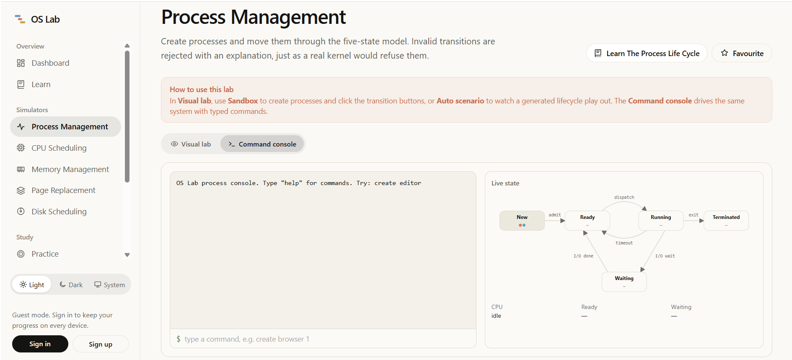
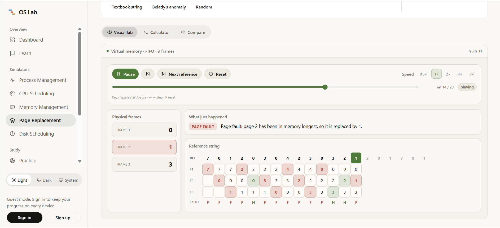

# OS Lab

By [Daniel Kwadwo Takyi](https://www.linkedin.com/in/dk-takyi) · [Repository](https://github.com/lankyghana/OS-Lab-Interactive-Operating-Systems-Simulator) · MIT licence

An interactive Operating Systems learning platform for university students. Run real OS algorithms, watch them execute step by step, check your hand calculations, and track your progress.

| Module | Algorithms | Visual lab | Text interface | Compare |
|---|---|---|---|---|
| Process Management | Five-state model, PCBs, ready/wait queues | Sandbox + auto scenario | Command console | — |
| CPU Scheduling | FCFS, SJF, SRTF, Priority (NP + P), Round Robin | Ready queue, CPU, Gantt, event log | Full metrics table | All 6 algorithms |
| Memory Management | First / Best / Worst Fit (variable + fixed partitions) | Memory map, hole search | Allocation table, fragmentation | Side by side |
| Page Replacement | FIFO, LRU, Optimal | Frames, hits/faults | Frame table, ratios | Faults vs. frames (Belady) |
| Disk Scheduling | FCFS, SSTF, SCAN, C-SCAN (+ LOOK, C-LOOK) | Moving head, seek graph | Move table, totals | Total head movement |

Plus **Learn** (16 topics: what, why, how, pros/cons, live worked example, further reading), a **Resources** library (19 hand-picked books, courses, videos and references with filters, save and done), **Practice** (seeded calculation exercises with worked solutions + 30 quiz questions), a **Dashboard** and **My Progress**. Every simulator has Start / Pause / Resume / Step / Back / Reset and five speeds (keyboard: Space, ←, →, R).

Product decisions taken from the brief's recommendations: **Hybrid** design (calm dashboard + dark lab bench inside simulators), **simulators + explanations + exercises + quizzes**, and **email/password + Google** sign-in. Guests can use everything; an account adds saved history, progress, favourites and cross-device exercises.

## Screenshots

| Process Management | CPU Scheduling |
|---|---|
|  |  |

| Page Replacement | Disk Scheduling |
|---|---|
|  |  |

## Repository layout

```
os-lab/
├── packages/engine      Framework-independent TypeScript simulation engine (+ tests)
├── apps/web             Next.js 15 frontend (App Router, Tailwind v4, shadcn-style UI)
│   ├── src/app          Thin route files
│   ├── src/features     One folder per module — all UI lives here
│   ├── src/components   UI kit, layout, charts, shared lab components
│   ├── src/content      Learn topics, module metadata, quiz bank
│   ├── demo/main.tsx    Standalone (hash-router) entry used for the static demo build
│   └── e2e              Playwright tests
├── apps/api             NestJS API + Prisma (PostgreSQL)
├── docs/ARCHITECTURE.md Architecture, data model, API reference
└── tools                Demo build + offline test runners
```

## Getting started

Requirements: Node 20+, pnpm 9, Docker (for PostgreSQL).

```bash
pnpm install
cp apps/api/.env.example apps/api/.env        # set JWT_SECRET (and Google keys if wanted)
cp apps/web/.env.example apps/web/.env.local
pnpm db:up                                    # start PostgreSQL
pnpm db:migrate                               # create tables (first run: name the migration "init")
pnpm dev                                      # web on :3000, API on :4000
```

Frontend only (guest mode, no database): leave `NEXT_PUBLIC_API_URL` empty and run `pnpm dev:web`.

Google sign-in: create an OAuth client (type *Web application*) with redirect URI `http://localhost:4000/auth/google/callback`, then fill `GOOGLE_CLIENT_ID` / `GOOGLE_CLIENT_SECRET`.

## Testing

```bash
pnpm test        # engine (31 tests against textbook answers) + API unit tests — Vitest
pnpm test:e2e    # Playwright, desktop + mobile
pnpm typecheck
```

## Deployment

- **Frontend → Vercel**: import the repo, set *Root Directory* to `apps/web`, set `NEXT_PUBLIC_API_URL` to the API URL.
- **API + PostgreSQL → Render**: `render.yaml` is a ready blueprint. Set `WEB_URL` (your Vercel URL) and the Google variables, and update `GOOGLE_CALLBACK_URL` to `https://<api>/auth/google/callback`.

## Contributing

OS Lab is open source under the [MIT licence](LICENSE). Contributions of code, explanations, quiz questions and resources are welcome. Start with [CONTRIBUTING.md](CONTRIBUTING.md) (also in the app at `/contribute`) and the [Code of Conduct](CODE_OF_CONDUCT.md). Report security issues privately as described in [SECURITY.md](SECURITY.md).

Maintainer details shown on the About page and the repository link used in the setup commands are configured in `apps/web/src/content/about.ts`.

## Static demo build

`pnpm build:demo` bundles the real frontend features into a single self-contained `dist/os-lab-demo.html` (guest mode). Useful for sharing a preview without any hosting.

## Conventions used by the simulators

- Priority: lower number = higher priority. Ties: earliest arrival, then input order; preemptive algorithms keep the running process on a tie.
- Round Robin: processes arriving at the moment a quantum expires join the queue *before* the preempted process.
- Memory: *variable* partitioning splits holes (textbook exercise style); *fixed* allows one process per block.
- SCAN / C-SCAN go to the physical end of the disk; the C-SCAN return sweep is counted by default (toggleable).
